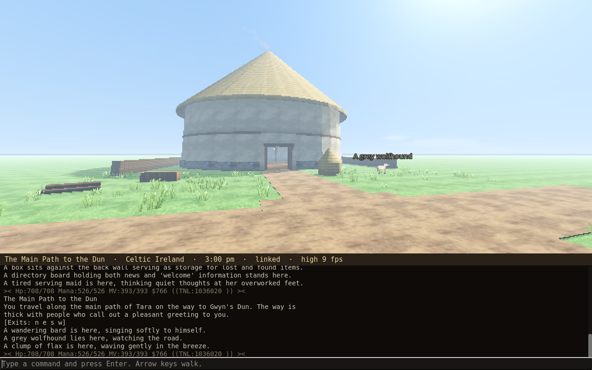
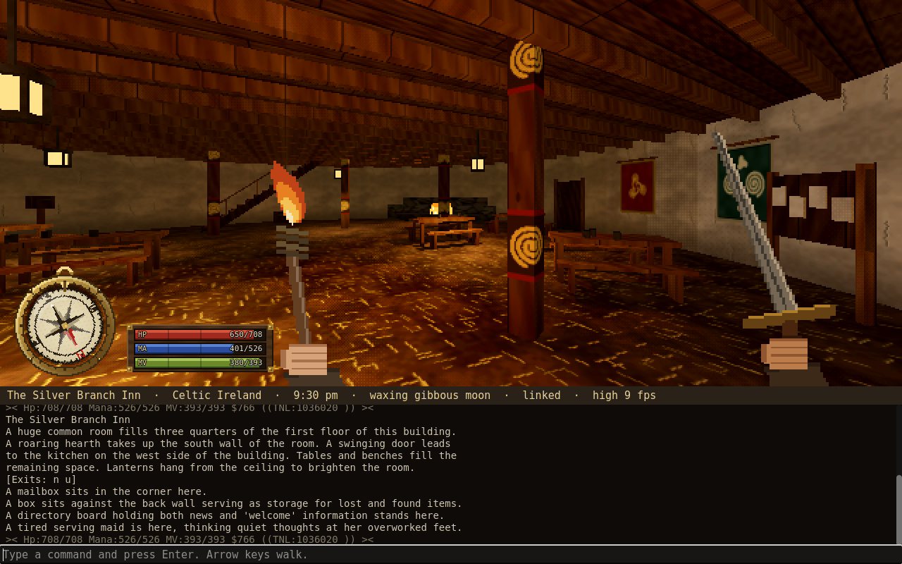
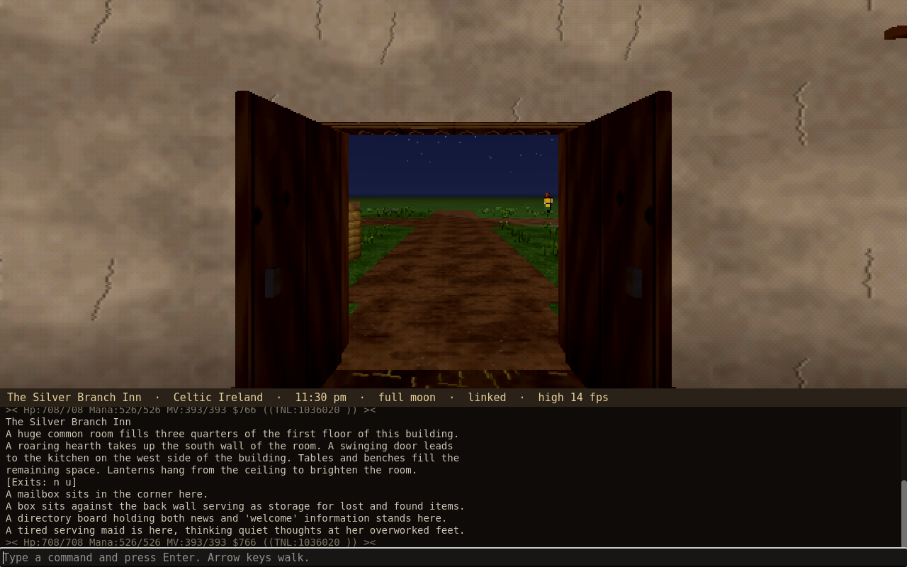
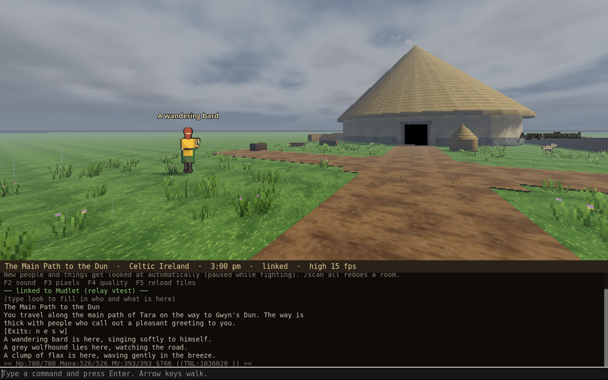
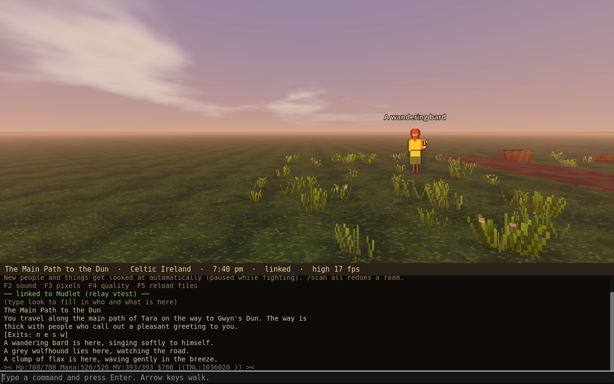
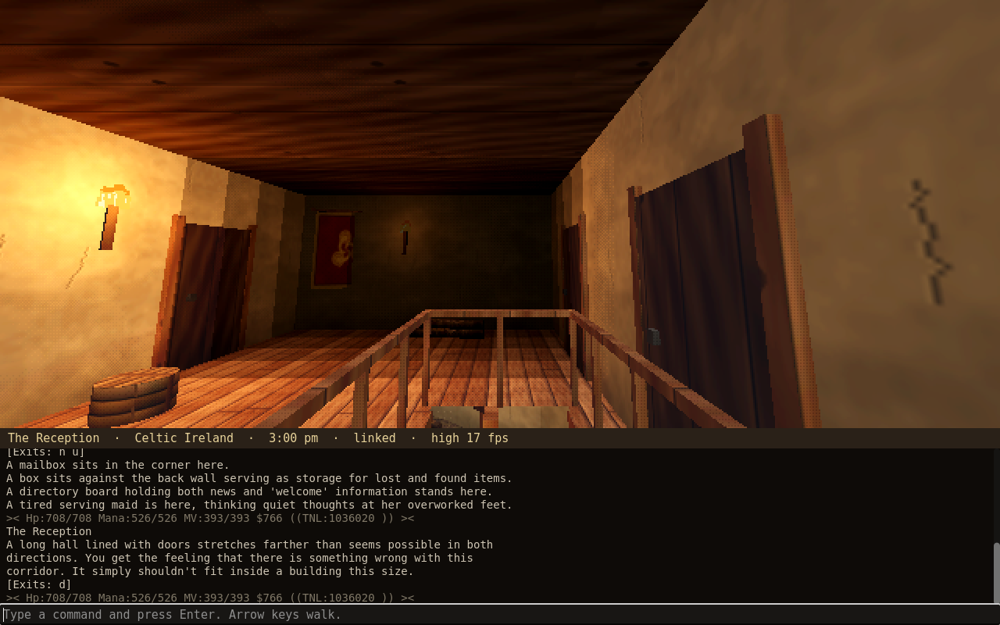
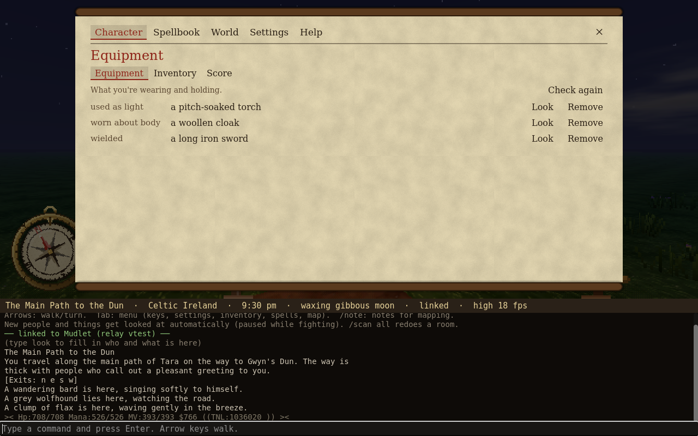
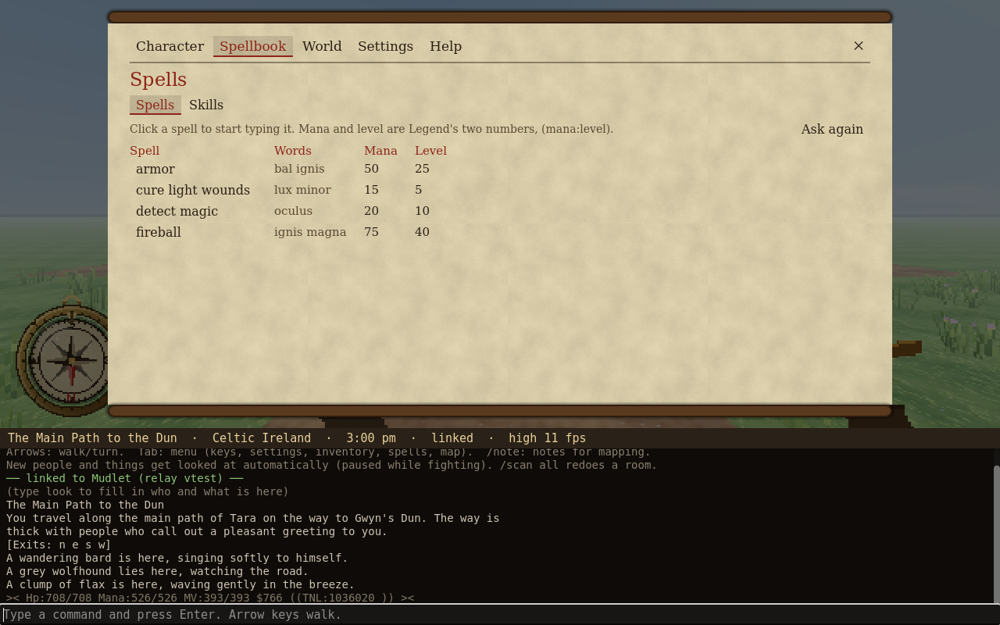

# Legend3D

**A 3D world for [LegendMUD](https://www.legendmud.org), built from the game's own text.**

By **Arkhanst**.

Legend3D runs beside [Mudlet](https://www.mudlet.org). Mudlet stays
connected to Legend and keeps all your scripts, aliases and triggers;
Legend3D reads what Legend tells you (room descriptions, exits, who's
here, the time, the weather, your health) and draws it as a first-person
3D world you can walk around in, in the spirit of Meridian 59 and
Daggerfall. You still type commands exactly as you always have.

Every room is built from its own description. Legend never sends 3D
data; Legend3D reads the words, the way you do.

| | |
|---|---|
|  |  |
|  |  |
|  |  |

---

## What it does

### The world
- **Rooms built from their descriptions:** size from what the room is
  (hut, house, hall, great hall), shape from the words ("a long hall lined
  with doors"), furnishings placed where the text puts them ("a loom
  taking up the entire west side").
- **Persistent:** every room you visit is saved and furnished once; it
  looks the same every visit and every session. Nothing pops in.
- **Period style:** Celtic Ireland around 300 BC: roundhouses with
  drystone footings, daubed walls, painted posts with La Tène spirals,
  thick conical thatch, smoke seeping out through the roof, wall
  hangings, rushes on earth floors.
- **Buildings with upper floors** built as one building: taller from the
  street, a real floor overhead, stairs that arrive somewhere.
- **Doors** open and closed, read from Legend's `[Exits: [n] s]` and
  remembered.
- **Outdoors** follows the text too: palisades, hedges, walls, treelines,
  water, open ground between rooms.

### Who's here
- **People and animals** from the room listing, as sprites with names.
  Animals are drawn as animals at real size; `(2) A muddy pig` is two
  pigs.
- **Auto-scan:** Legend3D quietly `look`s at anything new, learns names
  ("a tired serving maid" is Tika), clothing, colors and what they hold,
  and saves it in an NPC catalog you can edit. Never during a fight.

### Light, sky and weather
- Sun and moon move with **Legend's clock and calendar**, with seasonal
  day length at Tara's latitude.
- **Moon phase from Legend's almanac** sets how bright the night is.
- **Legend's weather**: clouds, rain, snow, fog, storms with lightning.
- Firelight, lanterns and torches, each casting its own shadows; light
  falling through doors and windows; sun rays toward a low sun.
- A quiet background check of `time` and `weather` keeps it all in step,
  hidden from your Mudlet window.

### Playing
- Arrow keys to walk; walk through a doorway and the move is sent to
  Legend. Walk up and down real stairs.
- **Right-click mouse look**, up and down too.
- **HUD:** a brass compass that turns as you do, and health, mana and
  moves bars.
- **Your weapon and light in hand**, first person. A carried torch or
  lantern lights the scene.
- **Menu (Tab):** equipment, inventory (with commands per item), score,
  spellbook (click to cast), a map of everything explored, mapping notes,
  the NPC catalog, settings.
- **Every key rebindable**, plus your own shortcut keys for commands.
- **`/note`** to jot down what the text can't say ("this room touches the
  inn on the west"), for laying out towns.

### Runs on modest hardware
Built for an Intel UHD 600 laptop on Linux Mint: Godot's compatibility
renderer, low-resolution pixel look, quality and pixel-size settings,
an FPS readout.

---

## What you need

- **[Mudlet](https://www.mudlet.org)**, connected to LegendMUD
- **[Godot 4.7](https://godotengine.org/download)** (the standard
  version; no C#/.NET needed)
- Developed and tested on Linux Mint. Mudlet and Godot also run on Windows
  and Mac, but Legend3D hasn't been tried there yet.

## Install

1. **Download** this repository (Code → Download ZIP) and unzip it.
2. **Mudlet:** drag `mudlet/Legend3D.xml` onto the Mudlet window (or
   Package Manager → Install). You'll see
   `[Legend3D] relay v0.4.0 loaded. Type 3d for status.`
3. **Godot:** Project Manager → **Import** → `godot/project.godot` →
   **Import & Edit**, then press **F5** (or ▶ Run Project).
4. The status bar says **linked**. Type `look` once, and start walking.

Start Mudlet and Legend3D in either order. To update, unzip the new
version over the old one, reinstall `Legend3D.xml` in Mudlet if the relay
version changed, and open the project with **Edit** once.

**Full guide: [HELP.md](HELP.md)**: every key, command and feature,
your data files, fixing rooms, troubleshooting.

## Trying it without the MUD

    python3 tools/fake_relay.py
    python3 tools/fake_relay.py --time "11:30 pm" --moon full
    python3 tools/fake_relay.py --weather "It is raining heavily and thunder rumbles in the distance."

`fake_relay.py` plays Mudlet's part with a small piece of Tara, so you can
walk around without logging in. `tools/test_listener.py` does the reverse
and checks that the Mudlet relay works.

---

## How it works

    LegendMUD  ⇄  Mudlet  ──(relay, local HTTP 127.0.0.1:7359)──  Legend3D (Godot)

- **`mudlet/`**: the relay, a small Lua package. It passes GMCP data
  (room, prompt, inventory, sounds) and every line of text to the view,
  runs the view's commands through your aliases, and does the hidden
  background checks.
- **`godot/`**: the 3D view. Rooms, props, sprites, textures and art are
  all generated in code; there are no bought or borrowed assets.
- **`PROTOCOL.md`**: the link between the two, for anyone curious.

Your explored world lives in `godot/data/` (`map.json`, `npcs.json`,
`notes.json`, `settings.json`, `room_overrides.json`). Those are personal
and are not part of this repository.

---

## Coming next

1. Real terrain: hills, cliffs, flying, and places bigger inside than out
2. Tara as one village: palisade, main gate, the dun, the forest beyond
3. Gwyn's Dun as a real three-level building
4. Daggerfall-style character sprites built from what NPCs wear
5. Other players
6. Interaction prompts ("sit here")

See **[CHANGELOG.md](CHANGELOG.md)** for everything done so far.

---

## About LegendMUD

[LegendMUD](https://www.legendmud.org) and its world, rooms, characters
and text belong to the LegendMUD team. Legend3D is a fan-made client
add-on by a player; it only displays what the game already sends to your
client. The test tool `tools/fake_relay.py` quotes a few rooms of Tara so
the view can be tried offline.
